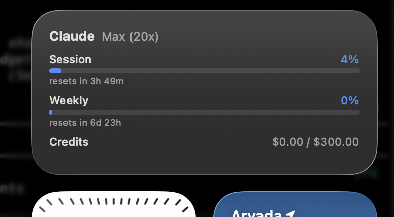
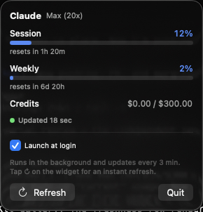

# Claude Usage Widget

A native macOS **Notification Center / desktop widget** that shows the limits from Claude Code's
`/usage` panel: current session, current week, and any per-model weekly limits. It also shows the
signed-in account email, plan label, and best-effort usage credits in the menu-bar popover and
medium widget.

<p align="center">
  
  &nbsp;&nbsp;
  
</p>

<p align="center">
  
  
  
</p>

> **Unofficial.** Claude Code's `/usage` prose is not a documented, stable interface. It may change
> at any time; parse failures retain the last good values with a **Stale** badge. This project is not
> affiliated with or endorsed by Anthropic. See [security & disclaimer](#security).

## ⚡ Install with Claude Code (easiest)

Clone the repo, open **Claude Code** in the repo folder, and paste this prompt:

```text
Install this macOS "Claude Usage" widget for me from this repo.
1. Read README.md and SECURITY.md, then tell me in 2 lines how the primary CLI usage fetch and the
   optional, in-memory usage-credits fetch handle authentication.
2. Check my prerequisites: macOS; Claude Code installed and signed in via `claude`; Xcode.app;
   Homebrew; and Xcode signed in with an Apple ID for a free Personal Team.
3. Install anything missing that is safe to install non-interactively (e.g. `brew install xcodegen`).
   If Xcode.app or the Xcode Apple-ID sign-in is missing, walk me through those manual steps.
4. Run `./scripts/install.sh` and show me any errors, fixing what you can.
5. When it builds, walk me through adding "Claude Usage" in Notification Center. Launch at login
   turns on automatically.
Explain each step briefly before running it, and never print raw Claude usage output.
```

Prefer to drive it yourself? Jump to [Manual install](#manual-install).

## Features

- **Session**, **Weekly**, and per-model **Weekly · <model>** utilization with live reset
  countdowns. Rows appear only when Claude's `/usage` output reports them.
- **Account context** — the signed-in email appears below the plan label on surfaces with room.
- **Usage credits (best effort)** — spent versus limit when Claude Code's promptless Keychain item
  remains available; this supplement auto-disables if access could start prompting.
- **Plan labels** from Claude Code (`Max`, `Pro`, `Team`, `Free`, or `Enterprise`). The CLI output
  does not expose Max's 5×/20× tier, so the widget intentionally shows simply `Max`.
- Anthropic-clay identity color (`#D97757`) with warmer severity escalation as a limit fills.
- **Tap-to-refresh (↻)** plus a live **Updated … ago** freshness indicator.
- A companion menu-bar readout, refresh button, notifications, and launch-at-login control.
- Runs locally with no project server or telemetry. The supplemental token is held in memory only
  for its direct Anthropic usage request and is never logged or persisted.

## How it works

```text
ClaudeUsage.app (non-sandboxed menu-bar agent)
        │
        ├─► claude auth status --json
        │      consume only loggedIn, email, subscriptionType
        │
        ├─► claude -p /usage --output-format json
        │      --strict-mcp-config --no-session-persistence
        │               │
        │               ▼
        │      whitelist three usage-bar line forms
        │
        └─► optional: /usr/bin/security (4 s deadline)
                    │ in-memory bearer token only
                    └─► GET api.anthropic.com/api/oauth/usage
                              whitelist spend fields only
                        │
                        ▼
~/Library/Application Support/ClaudeUsage/usage.json
                       ▲  read-only sandbox path exception
                       │
ClaudeUsageWidget (sandboxed WidgetKit extension) → renders in Notification Center
```

The agent spawns the Claude Code CLI, which handles its own authentication and network request. It
discards everything except auth status's `loggedIn`, `email`, and `subscriptionType` fields and the
three recognized `/usage` bar-line forms. In particular, the “What's contributing” analytics block
is never written to the snapshot.

Credits are a separate supplement. Their failure cannot make the CLI snapshot stale, change its
error, or prevent bars and email from being saved.

The widget reads one JSON file through a read-only sandbox path exception. This deliberately avoids
App Groups, which require a registered group identifier; local personal-team signing is sufficient.

## Requirements

- macOS 14+ (built and tested on macOS 26)
- [Claude Code](https://claude.com/claude-code) **installed and signed in via `claude`**
- **Xcode** and [XcodeGen](https://github.com/yonaskolb/XcodeGen) (`brew install xcodegen`)
- A free Apple ID (Personal Team) for local signing — no paid membership needed

## Manual install

Prerequisites: **Xcode.app**, `brew install xcodegen`, Claude Code signed in, and a one-time Xcode
sign-in (Settings ▸ Accounts) for a free Personal Team. From the repo root:

```bash
./scripts/install.sh             # auto-detects Team ID, builds, installs, launches
# make install                   # same thing
# ./scripts/install.sh <TEAM_ID> # if auto-detect cannot find your team
```

The credits read is promptless with Claude Code's current Keychain ACL. Open **Notification Center**
→ **Edit Widgets** → add **Claude Usage** (medium). Launch at login is enabled automatically on first
run and can be changed from the menu-bar gauge.

<details>
<summary>Prefer to run the steps yourself</summary>

```bash
brew install xcodegen
./scripts/configure.sh <TEAM_ID>   # generates local entitlements + the Xcode project
# Team ID: security find-certificate -c "Apple Development" -p | openssl x509 -noout -subject
open ClaudeUsage.xcodeproj         # ⌘R (or: make build)
```
</details>

### Verify the data layer without Xcode

```bash
make check        # or: swift run DataLayerCheck → "ALL CHECKS PASSED"
make live         # or: swift run DataLayerCheck --live (Claude CLI + best-effort credits)
bash scripts/fetch_usage.sh        # same two CLI calls, printing only recognized fields/lines
```

## Repo layout

| Path | What |
|------|------|
| `Shared/` | Model, primary CLI client, supplemental credits client, formatting, and store |
| `SharedUI/` | SwiftUI pieces shared by the menu-bar popover and widget |
| `ClaudeUsageApp/` | Background menu-bar agent, timer, notifications, and login item |
| `ClaudeUsageWidget/` | Sandboxed WidgetKit extension |
| `Tools/DataLayerCheck/` | Data-layer assertions that run with no Xcode project |
| `fixtures/` | Fabricated Claude CLI envelopes, prose, and auth status |
| `scripts/install.sh` | One-command configure/build/install/launch flow |
| `scripts/configure.sh` | Generates local entitlements and project with your Team ID |
| `scripts/fetch_usage.sh` | Bounded live CLI pipeline for debugging |
| `project.yml` | XcodeGen spec → `ClaudeUsage.xcodeproj` |

## Refresh behavior

- The agent refreshes automatically every 3 minutes and on demand when the menu opens or ↻ is
  tapped. Triggers are coalesced to at most one refresh per 20 seconds.
- Each refresh normally takes about **1.5–2 seconds** for `/usage`, plus roughly 0.2 seconds for auth
  status. The usage subprocess has a 30-second timeout; auth status has a 10-second timeout.
- `--strict-mcp-config` prevents configured MCP servers from connecting during a poll, and
  `--no-session-persistence` avoids writing a session transcript for every refresh.
- If auth status itself fails, the agent still attempts `/usage` with a generic `Claude` plan and no
  email. A confirmed signed-out status skips `/usage` and shows a fixed sign-in message.
- A failed or changed response never replaces good numbers: the prior snapshot is marked stale and
  the UI shows a fixed, non-sensitive error message.

## Usage credits (best effort)

Claude Code's `/usage` prose does not include the credits panel, so the app optionally reads Claude
Code's OAuth blob by spawning exactly `/usr/bin/security`, then sends the token only to Anthropic's
usage endpoint. That Keychain read is promptless today because Claude Code creates the item through
`/usr/bin/security`; the token stays in memory and only whitelisted spend values reach `usage.json`.

Anthropic has said this Keychain surface will be hardened. The read therefore has a four-second
breaker: a failed, malformed, or hung Keychain read—or an HTTP 403—turns **Show usage credits** off
permanently until the user turns it back on. Any non-instant read trips it, including one the user
approves: a promptless read takes about ten milliseconds, so a read that succeeds only after more
than a second is discarded as a prompt that someone answered. The worst case is one password dialog,
ever—never a second one on a later refresh. The menu shows the stored fixed reason when this
happens. Manually switching the option off also prevents reads, while switching it back on clears
both the manual/automatic disable and its reason.

HTTP 401, rate limiting, server errors, and network failures hide credits for that cycle without
tripping the breaker. In every case the CLI-derived bars, email, freshness, and error state continue
normally.

**Launch at login.** The agent must be running for the widget to stay current, so its first launch
registers it as a login item. Keep the app in `/Applications`; `SMAppService` may refuse a DerivedData
or quarantined copy. Verify it with `pgrep -lf ClaudeUsage.app/Contents/MacOS/ClaudeUsage` or open the
menu-bar gauge and inspect the freshness row.

## Security

The primary pipeline launches Claude Code with a minimal environment allowlist, closes stdin, and
discards stderr. The optional credits supplement reads one token through `/usr/bin/security`, holds
it only in memory for the Anthropic usage endpoint, and auto-disables when promptless access looks
unsafe. The snapshot directory is mode `0700`, and `usage.json` is mode `0600`. Full details are in
[SECURITY.md](SECURITY.md).

## Roadmap

- `systemSmall` polish and optional multi-account support.
- A signed, notarized release build so friends can install without Xcode.

## License

[MIT](LICENSE) © 2026 Andres Milioto. Not affiliated with Anthropic.
